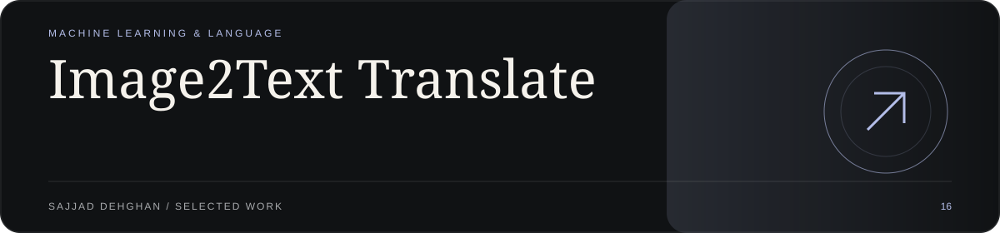
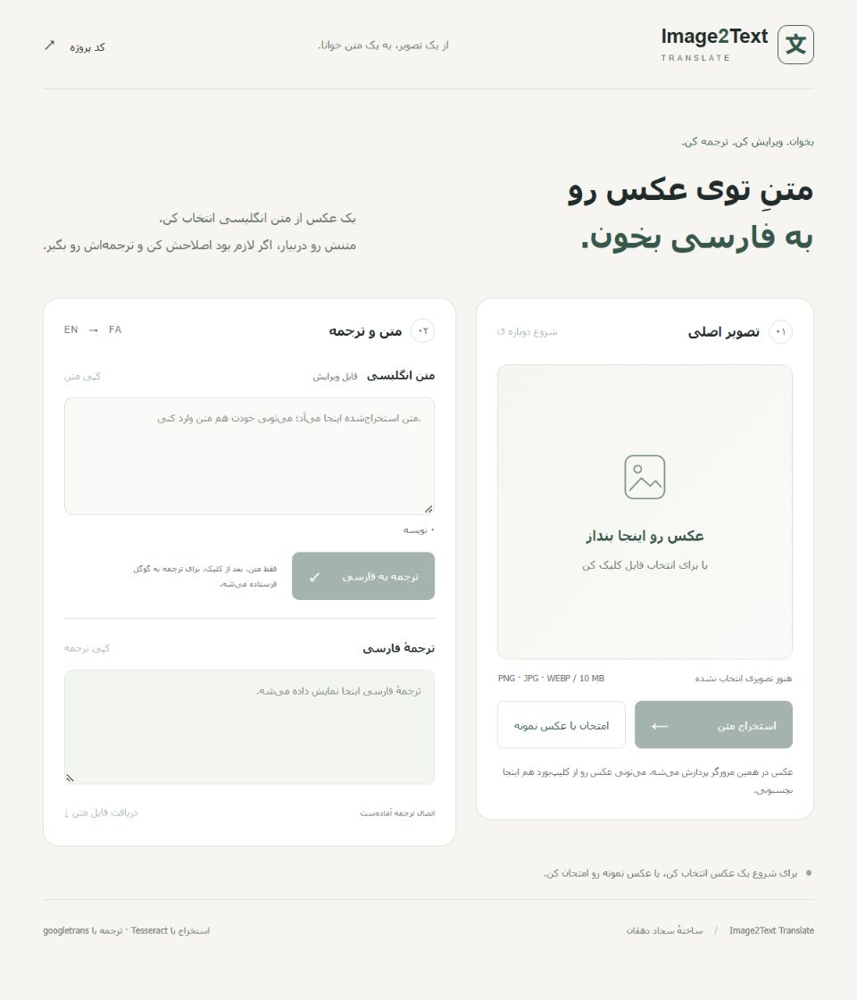
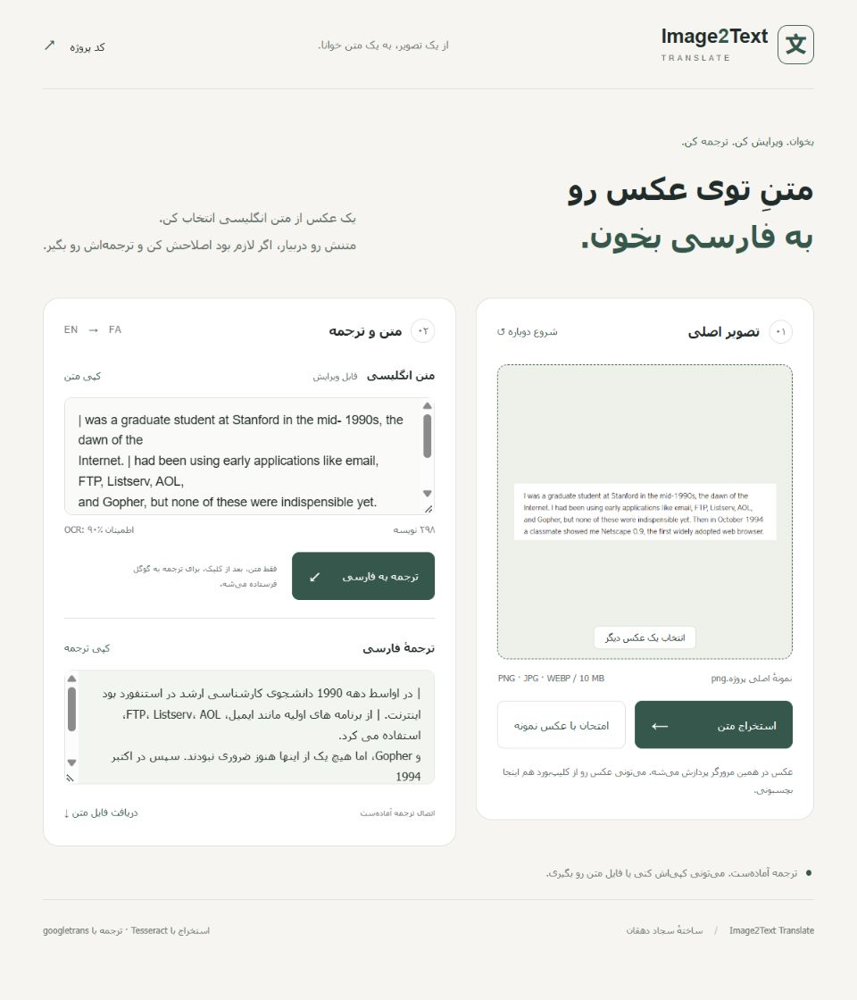
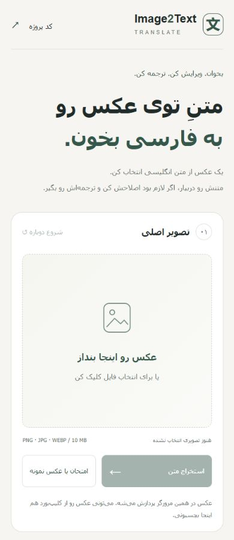
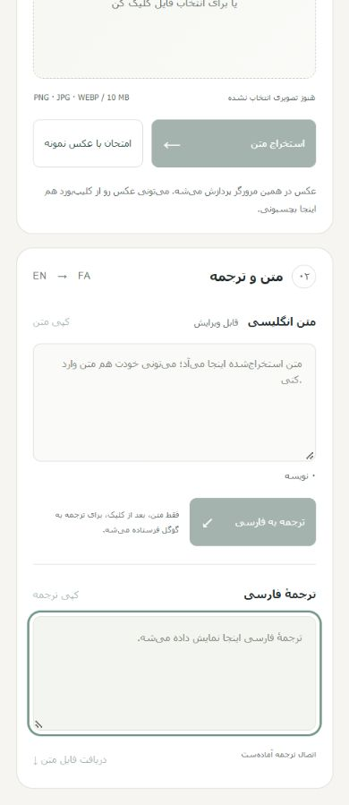

<p align="center">
  
</p>

# Image2Text Translate

Read English text from an image, correct it, and translate it into Persian. A small Persian-first web interface built around the project's original Tesseract + Python translation pipeline.

[Project showroom](https://sajjad-dehghan.ir/fa/projects/image2text-translate) · [Run locally](#run-the-web-interface) · [Command line](#command-line)

## The interface



- Choose, drop, or paste a PNG, JPG, or WebP image. The preview fits the frame without cropping.
- Extract English text with **Tesseract.js** in your browser, then edit recognition mistakes.
- Translate the edited text into Persian through a local Python server using **googletrans**.
- Copy either result or download both as a UTF-8 text file.
- Reset the workspace and start with another image. The layout becomes a single column on mobile.

### A real sample run



This capture uses the existing `photo/2.png` sample. Both the OCR text and Persian result came from a real run, not prefilled demonstration output. OCR can misread characters (including `I` as `|`); the editable English field lets you correct them before translating. The displayed confidence is Tesseract's estimate for this image, not a general accuracy score.

## Run the web interface

<details>
<summary>Mobile screenshots</summary>

<p>
  
  
</p>
</details>

Requirements: **Python 3.10+**, **Node.js 20+**, npm, and internet access for the initial dependency/model download and online translation. Native Tesseract is **not** required for the web interface.

```sh
git clone https://github.com/sajjad-dehghan/Image2Text-Translate.git
cd Image2Text-Translate
npm ci
npm run prepare:web
python -m venv .venv
```

Windows:

```powershell
.venv/Scripts/python.exe -m pip install -r requirements.txt
.venv/Scripts/python.exe src/server.py
```

macOS / Linux:

```sh
.venv/bin/python -m pip install -r requirements.txt
.venv/bin/python src/server.py
```

Open **http://127.0.0.1:4319/**. Use `--port 4321` if that port is busy.

`prepare:web` copies the installed Tesseract.js runtime and core variants into `web/vendor/`, downloads the English model from a pinned official `tessdata_fast` revision, and verifies its Git blob checksum. Generated assets and dependencies are ignored by Git. If a download is interrupted, rerun the command; incomplete models are not accepted.

## How it works

1. The browser reads the image as a local file and runs Tesseract's English OCR in a Web Worker using locally served WebAssembly/model assets.
2. The recognized text appears in an editable field. Selecting another image or editing the text clears any previous translation.
3. Only when **Translate** is clicked, the text is sent to the loopback Python server. The server calls Google Translate through the asynchronous `googletrans` library and returns the Persian result.
4. Translation failure is shown as an error while the extracted text remains available. There is no fabricated success response or offline translation fallback.

The updated CLI translates the whole extracted text rather than splitting on every period, so version numbers, abbreviations, and line breaks are not deliberately fragmented.

## Privacy and limits

- Images are processed in the browser, not uploaded to the Python server or Google.
- Text is sent to Google when translation is requested. Do not translate confidential content unless you are comfortable with that disclosure.
- The application does not save images, text, or translation history; refresh/reset clears the workspace. Browser/runtime assets may be cached by the browser.
- Image limit: **10 MB** and **24 megapixels**. Text limit: **12,000 characters**.
- OCR supports **English**, with Persian as the translation target. Recognition quality depends on image clarity and typography.
- `googletrans` is an unofficial client for an online service; connection failures, provider changes, or rate limits can stop translation. It is not a production translation SLA.
- The server binds only to **127.0.0.1**, restricts Host/Origin, validates a per-process CSRF token, and limits concurrent translations. Restarting the server requires reloading the page.
- This is a **local tool**, not an internet-facing deployment. Do not expose the standard-library development server publicly. A static hosting upload alone does not provide the Python translation API.

## Command line

The native Python workflow remains available. Install [Tesseract OCR](https://github.com/tesseract-ocr/tesseract) with English language data and the Python requirements above.

```sh
python src/main.py photo/2.png
python src/main.py photo/2.png --ocr-only
```

If Tesseract is not on PATH:

```powershell
python src/main.py photo/2.png --tesseract "C:/Program Files/Tesseract-OCR/tesseract.exe"
```

You can also set `TESSERACT_CMD`. With no image argument, the CLI uses the repository sample. There are no user-specific hard-coded paths. It prints the English text followed by its Persian translation; errors leave the already printed OCR text intact.

## Tests

```sh
npm test
python -m unittest discover -s tests -p "test_*.py"
```

Tests cover image/text validation, text-file output, same-origin/CSRF enforcement, path confinement, and translation error handling. Provider responses are mocked only in unit tests. Real browser OCR and online translation were additionally checked with the repository sample; native CLI OCR still requires a separately installed Tesseract executable.

## Project structure

```text
web/                    Persian HTML/CSS/JavaScript interface
web/vendor/             Generated browser OCR assets (ignored)
src/server.py           Loopback static server + translation API
src/main.py             Native Python OCR / translation CLI
scripts/prepare-web.mjs  Reproducible browser OCR setup
tests/                  JavaScript and Python tests
photo/2.png             Original English sample
docs/showroom/          Real interface screenshots and repository cover
```

## Built with

[Tesseract.js](https://github.com/naptha/tesseract.js) · [Tesseract OCR](https://github.com/tesseract-ocr/tesseract) · [English model](https://github.com/tesseract-ocr/tessdata_fast) · [pytesseract](https://github.com/madmaze/pytesseract) · [Pillow](https://python-pillow.org/) · [googletrans](https://github.com/ssut/py-googletrans)
